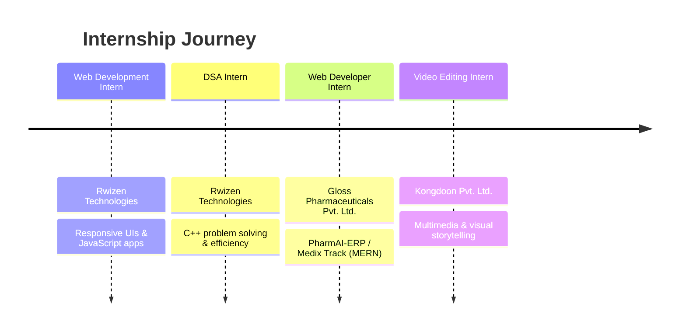
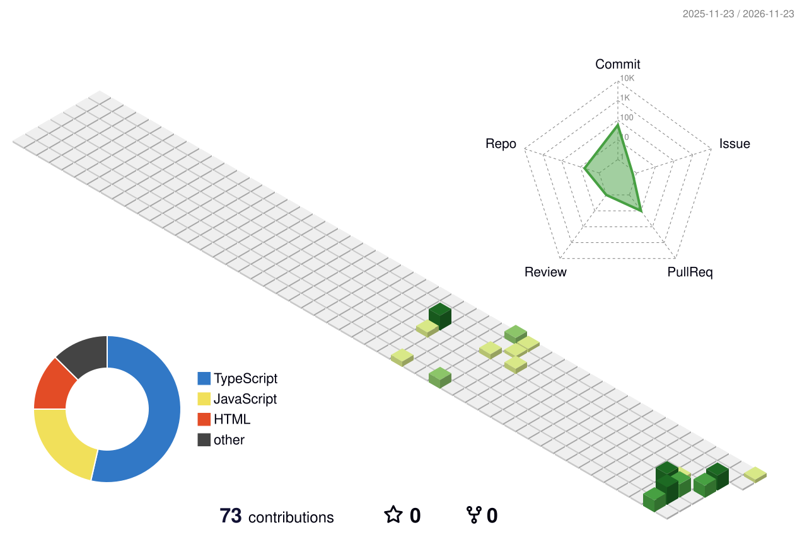

<!-- ═══════════════════════════════════════════════════════════════════
     KAPIL ROHILLA · GITHUB PROFILE README
     Animated edition · palette: #0d1117 / #0f2027 / #36BCF7 / #8A2BE2
     ═══════════════════════════════════════════════════════════════════ -->

<!-- ══════════════════════ HEADER ══════════════════════ -->
<div align="center">


<a href="https://github.com/kapilrohilla225">
  
</a>

<br/>


<br/><br/>

<a href="https://www.linkedin.com/in/kapil-rohilla225/"></a>
<a href="mailto:kapilrohilla206@gmail.com"></a>
<a href="https://github.com/kapilrohilla225?tab=repositories"></a>

<br/>


<br/><br/>

<sub><b>Personal profile repo</b> — this is my own space. Every project below lives in its own repository with its own docs, issues and commit history.</sub>

</div>


<!-- ══════════════════════ ABOUT ══════════════════════ -->
<h2 align="center">👨‍💻 About Me</h2>

<table>
<tr>
<td width="60%" valign="top">

```js
const kapil = {
  role: "Final-Year B.Tech CSE Student",
  college: "Geeta University, Panipat",
  focus: ["MERN Stack", "Backend Engineering", "System Design"],
  practicing: "Data Structures & Algorithms in C++",
  tools: ["Git", "GitHub", "Postman", "VS Code"],
  goal: "Software Development Engineer (SDE)",
  currentlyLearning: ["Scalable Architecture", "Advanced DSA"],
  openTo: ["Internships", "Collaboration", "Impactful Projects"],
};
```

</td>
<td width="40%" valign="top">

- 🌐 Building full-stack apps with the **MERN stack**
- ⚙️ Passionate about **REST APIs**, database design & scalability
- 🤝 Comfortable with **Git workflows** and team-based development
- 🎯 Aspiring **SDE** focused on writing clean, reliable code

</td>
</tr>
</table>

<p align="center">
  <sub>🎬 Also spent time on <b>video editing &amp; visual storytelling</b> during my Kongdoon internship — useful for demo videos and product walkthroughs.</sub>
</p>

<div align="center">


</div>


<!-- ══════════════════════ TECH STACK ══════════════════════ -->
<h2 align="center">🛠️ Tech Stack</h2>

<div align="center">

| | Technologies |
|:---:|:---|
| **Languages** |  |
| **Frontend** |  |
| **Backend** |  |
| **Databases** |  |
| **Tools** |  |

<br/>


</div>

**Core Competencies:** `Data Structures & Algorithms` · `REST API Development` · `JWT Authentication & Authorization` · `Role-Based Access Control` · `Database Management` · `Problem Solving`


<!-- ══════════════════════ PROJECTS ══════════════════════ -->
<h2 align="center">🚀 Featured Projects</h2>

<div align="center">
<sub>My own work and contributions only — full documentation, setup steps and issues stay inside each project repo.</sub>
</div>

<table>
<tr>
<td width="50%" valign="top">

### 🧠 MockKernel
**AI Mock Interview & Coding Platform** · `team project — 6 members`

A collaborative platform combining coding practice with AI-powered interview preparation — built by a team, with my work focused on the backend.

`MERN` `TypeScript` `MongoDB` `Redis` `Judge0 API` `Gemini AI`

- Backend Developer in a **six-member team**
- Owner of the **Contest module** backend
- Database schema design & REST API development
- Integrated online code execution via Judge0
- Exploring AI-driven interview feedback

<a href="https://github.com/PranshulCSE/MockKernel"></a>

<br/><br/>


</td>
<td width="50%" valign="top">

### 💊 PharmAI-ERP
**Pharmaceutical ERP Application** · `internship project`

A full-stack ERP to manage pharmaceutical business operations, built during my internship.

`MongoDB` `Express.js` `React.js` `Node.js`

- Developed backend APIs and application modules
- Implemented **authentication & role-based access**
- Integrated **MongoDB Atlas** for data management
- Frontend ↔ backend integration
- Built practical ERP features for real operations

<a href="https://github.com/kapilrohilla225/PharmAI-ERP"></a>

<br/><br/>


</td>
</tr>
</table>

<details>
<summary><b>🌐 More: Web Development Projects</b></summary>
<br/>

Practical projects built while learning and applying web development concepts.

**Stack:** HTML · CSS · JavaScript · React.js

- Interactive, responsive web interfaces
- JavaScript functionality and DOM-driven apps
- Stronger frontend debugging and UI skills

🔗 [Explore all repositories](https://github.com/kapilrohilla225?tab=repositories)

</details>


<!-- ══════════════════════ EXPERIENCE ══════════════════════ -->
<h2 align="center">💼 Experience</h2>



<details open>
<summary><b>🏢 Web Developer Intern — Gloss Pharmaceuticals Pvt. Ltd.</b></summary>
<br/>

- Worked on **PharmAI-ERP / Medix Track**, a pharmaceutical ERP application
- Built full-stack features using **MongoDB Atlas, Express.js, React.js and Node.js**
- Implemented backend APIs and application modules

</details>

<details>
<summary><b>🏢 Web Development Intern — Rwizen Technologies</b></summary>
<br/>

- Worked on practical web development projects
- Built responsive interfaces and JavaScript-based applications
- Gained hands-on frontend experience

</details>

<details>
<summary><b>🏢 DSA Intern — Rwizen Technologies</b></summary>
<br/>

- Practiced Data Structures & Algorithms using **C++**
- Solved coding challenges and problem-solving exercises
- Improved logical thinking and algorithmic efficiency

</details>

<details>
<summary><b>🏢 Video Editing Intern — Kongdoon Pvt. Ltd.</b></summary>
<br/>

- Worked on video editing and multimedia content creation
- Developed practical editing and visual storytelling skills

</details>


<!-- ══════════════════════ DSA ══════════════════════ -->
<h2 align="center">🧠 DSA & Problem Solving</h2>

<div align="center">


<a href="https://leetcode.com/"></a>
<a href="https://www.geeksforgeeks.org/"></a>

</div>

<br/>

| Fundamentals | Intermediate | Advanced |
|:---|:---|:---|
| Arrays & Strings | Linked Lists | Trees & Graphs |
| Searching & Sorting | Stacks & Queues | Dynamic Programming |
| Recursion | Backtracking | Greedy Algorithms |

<!-- 🔥 Uncomment once you know your LeetCode handle (replace YOUR_LEETCODE_HANDLE):
<div align="center">

</div>
-->


<!-- ══════════════════════ ANALYTICS ══════════════════════ -->
<h2 align="center">📊 GitHub Analytics</h2>

<div align="center">


<br/><br/>


<br/><br/>


<br/><br/>


</div>


<!-- ══════════════════════ SNAKE + 3D ══════════════════════ -->
<h2 align="center">🐍 Contribution Snake</h2>

<div align="center">

<picture>
  <source media="(prefers-color-scheme: dark)" srcset="https://raw.githubusercontent.com/kapilrohilla225/kapilrohilla225/output/github-snake-dark.svg" />
  <source media="(prefers-color-scheme: light)" srcset="https://raw.githubusercontent.com/kapilrohilla225/kapilrohilla225/output/github-snake.svg" />
  
</picture>

</div>

<h2 align="center">🧊 3D Contribution Graph</h2>

<div align="center">



</div>


<!-- ══════════════════════ FOCUS ══════════════════════ -->
<h2 align="center">🎯 Current Focus</h2>

<details open>
<summary><b>What I'm working on right now</b></summary>
<br/>

- [x] Ship full-stack features on **MockKernel** (Contest module backend)
- [x] Build backend APIs for **PharmAI-ERP** with MongoDB Atlas
- [x] Implement **JWT auth** + role-based access control
- [ ] Go deeper into **system design** & **scalable architecture**
- [ ] Backend performance tuning & **API security** hardening
- [ ] More **DSA in C++** — trees, graphs, DP, greedy

</details>

<details>
<summary><b>How I like to work</b></summary>
<br/>

> - **Understand the problem first** — then pick the simplest design that scales.
> - **Clean code over clever code.** Readable today, maintainable next month.
> - **API-first thinking:** clear contracts, sane status codes, predictable errors.
> - **Ship small, ship often**, then improve with real feedback.

</details>

<div align="center">


</div>


<!-- ══════════════════════ CONNECT ══════════════════════ -->
<h2 align="center">🤝 Let's Connect</h2>

<div align="center">

I'm always open to **internships, collaboration, and impactful software projects**.

<a href="https://github.com/kapilrohilla225"></a>
<a href="https://www.linkedin.com/in/kapil-rohilla225/"></a>
<a href="mailto:kapilrohilla206@gmail.com"></a>

<br/>


</div>
