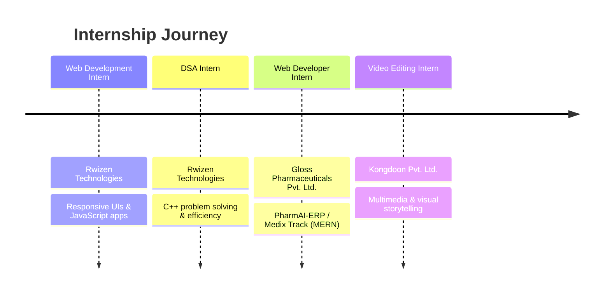

<!-- ===================== HEADER ===================== -->
<div align="center">


<a href="https://github.com/kapilrohilla225">
  
</a>

<br/>


<br/><br/>

<a href="https://www.linkedin.com/in/kapil-rohilla225/"></a>
<a href="mailto:kapilrohilla206@gmail.com"></a>
<a href="https://github.com/kapilrohilla225?tab=repositories"></a>


</div>

<br/>

---

## 👨‍💻 About Me

<table>
<tr>
<td width="62%" valign="top">

```js
const kapil = {
  role: "Final-Year B.Tech CSE Student",
  college: "Geeta University, Panipat",
  focus: ["MERN Stack", "Backend Engineering", "System Design"],
  practicing: "Data Structures & Algorithms in C++",
  tools: ["Git", "GitHub", "Postman", "VS Code"],
  goal: "Software Development Engineer (SDE)",
  currentlyLearning: ["Scalable Architecture", "Advanced DSA"],
  openTo: ["Internships", "Collaboration", "Impactful Projects"],
};
```

</td>
<td width="38%" valign="top">

- 🌐 Building full-stack apps with the **MERN stack**
- ⚙️ Passionate about **REST APIs**, database design & scalability
- 🤝 Comfortable with **Git workflows** and team-based development
- 🎯 Aspiring **SDE** focused on writing clean, reliable code

</td>
</tr>
</table>

---

## 🛠️ Tech Stack

<div align="center">

| | Technologies |
|:---:|:---|
| **Languages** |  |
| **Frontend** |  |
| **Backend** |  |
| **Databases** |  |
| **Tools** |  |

</div>

**Core Competencies:** `Data Structures & Algorithms` · `REST API Development` · `JWT Authentication & Authorization` · `Role-Based Access Control` · `Database Management` · `Problem Solving`

---

## 🚀 Featured Projects

<table>
<tr>
<td width="50%" valign="top">

### 🧠 MockKernel
**AI Mock Interview & Coding Platform**

A collaborative platform combining coding practice with AI-powered interview preparation.

`MERN` `TypeScript` `MongoDB` `Redis` `Judge0 API` `Gemini AI`

- Backend Developer in a **six-member team**
- Owner of the **Contest module** backend
- Database schema design & REST API development
- Integrated online code execution via Judge0
- Exploring AI-driven interview feedback

<a href="https://github.com/PranshulCSE/MockKernel"></a>

</td>
<td width="50%" valign="top">

### 💊 PharmAI-ERP
**Pharmaceutical ERP Application**

A full-stack ERP to manage pharmaceutical business operations.

`MongoDB` `Express.js` `React.js` `Node.js`

- Developed backend APIs and application modules
- Implemented **authentication & role-based access**
- Integrated **MongoDB Atlas** for data management
- Frontend ↔ backend integration
- Built practical ERP features for real operations

<a href="https://github.com/kapilrohilla225/PharmAI-ERP"></a>

</td>
</tr>
</table>

<details>
<summary><b>🌐 More: Web Development Projects</b></summary>
<br/>

Practical projects built while learning and applying web development concepts.

**Stack:** HTML · CSS · JavaScript · React.js

- Interactive, responsive web interfaces
- JavaScript functionality and DOM-driven apps
- Stronger frontend debugging and UI skills

🔗 [Explore all repositories](https://github.com/kapilrohilla225?tab=repositories)

</details>

---

## 💼 Experience



<details open>
<summary><b>🏢 Web Developer Intern — Gloss Pharmaceuticals Pvt. Ltd.</b></summary>
<br/>

- Worked on **PharmAI-ERP / Medix Track**, a pharmaceutical ERP application
- Built full-stack features using **MongoDB Atlas, Express.js, React.js and Node.js**
- Implemented backend APIs and application modules

</details>

<details>
<summary><b>🏢 Web Development Intern — Rwizen Technologies</b></summary>
<br/>

- Worked on practical web development projects
- Built responsive interfaces and JavaScript-based applications
- Gained hands-on frontend experience

</details>

<details>
<summary><b>🏢 DSA Intern — Rwizen Technologies</b></summary>
<br/>

- Practiced Data Structures & Algorithms using **C++**
- Solved coding challenges and problem-solving exercises
- Improved logical thinking and algorithmic efficiency

</details>

<details>
<summary><b>🏢 Video Editing Intern — Kongdoon Pvt. Ltd.</b></summary>
<br/>

- Worked on video editing and multimedia content creation
- Developed practical editing and visual storytelling skills

</details>

---

## 🧠 DSA & Problem Solving

<div align="center">


<a href="https://leetcode.com/"></a>
<a href="https://www.geeksforgeeks.org/"></a>

</div>

<br/>

| Fundamentals | Intermediate | Advanced |
|:---|:---|:---|
| Arrays & Strings | Linked Lists | Trees & Graphs |
| Searching & Sorting | Stacks & Queues | Dynamic Programming |
| Recursion | Backtracking | Greedy Algorithms |

---

## 📊 GitHub Analytics

<div align="center">


<br/>


<br/>


<br/>


</div>

---

## 🐍 Contribution Snake

<div align="center">

<picture>
  <source media="(prefers-color-scheme: dark)" srcset="https://raw.githubusercontent.com/kapilrohilla225/kapilrohilla225/output/github-snake-dark.svg" />
  <source media="(prefers-color-scheme: light)" srcset="https://raw.githubusercontent.com/kapilrohilla225/kapilrohilla225/output/github-snake.svg" />
  
</picture>

</div>

---

## 🤝 Let's Connect

<div align="center">

I'm always open to **internships, collaboration, and impactful software projects**.

<a href="https://github.com/kapilrohilla225"></a>
<a href="https://www.linkedin.com/in/kapil-rohilla225/"></a>
<a href="mailto:kapilrohilla206@gmail.com"></a>

<br/><br/>


</div>
